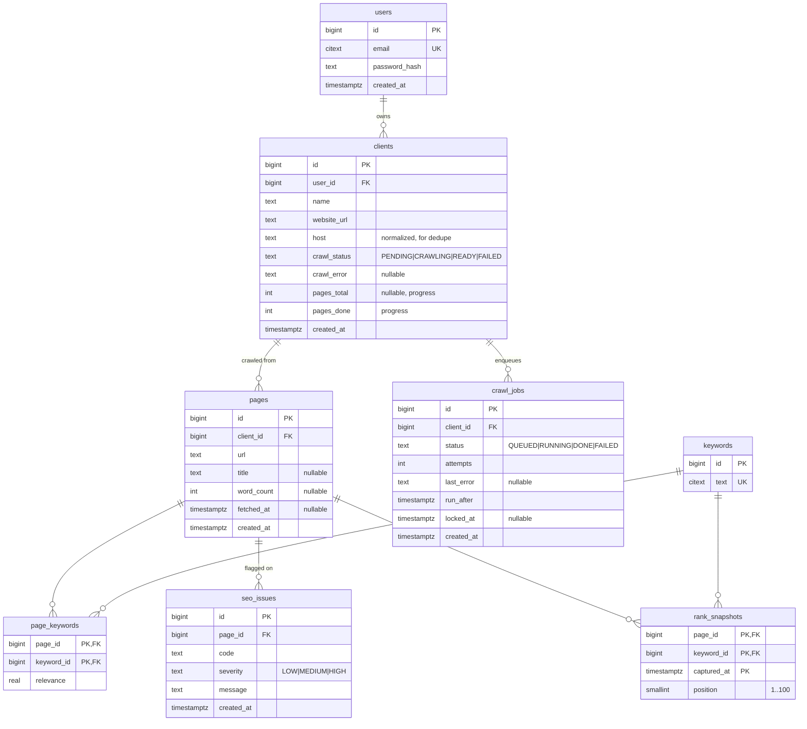

# Database

The data model for the SEO keyword tracker. PostgreSQL, accessed with raw SQL (see `decisions.md`). This document is the source of truth for the schema; `api/db/schema.sql` must match it.

The domain has six things: **users, clients, pages, keywords, SEO issues, and rank snapshots**. A client belongs to one user and has a website. A page is one URL on that website. A keyword is a term a page is likely to rank for (many-to-many). An SEO issue is a problem found on a page. A rank snapshot is the position of one page for one keyword on one date.

## ER diagram



## DDL (`api/db/schema.sql`)

```sql
CREATE EXTENSION IF NOT EXISTS citext;

CREATE TABLE users (
  id            bigserial PRIMARY KEY,
  email         citext UNIQUE NOT NULL,
  password_hash text   NOT NULL,
  created_at    timestamptz NOT NULL DEFAULT now()
);

CREATE TABLE clients (
  id           bigserial PRIMARY KEY,
  user_id      bigint NOT NULL REFERENCES users(id) ON DELETE CASCADE,
  name         text   NOT NULL,
  website_url  text   NOT NULL,
  host         text   NOT NULL,                       -- normalized for dedupe
  crawl_status text   NOT NULL DEFAULT 'PENDING'
                 CHECK (crawl_status IN ('PENDING','CRAWLING','READY','FAILED')),
  crawl_error  text,
  pages_total  int,                                   -- crawl progress (for "7/15" UX)
  pages_done   int    NOT NULL DEFAULT 0,
  created_at   timestamptz NOT NULL DEFAULT now(),
  UNIQUE (user_id, host)
);

CREATE TABLE pages (
  id         bigserial PRIMARY KEY,
  client_id  bigint NOT NULL REFERENCES clients(id) ON DELETE CASCADE,
  url        text   NOT NULL,
  title      text,
  word_count int,
  fetched_at timestamptz,
  created_at timestamptz NOT NULL DEFAULT now(),
  UNIQUE (client_id, url)
);

CREATE TABLE keywords (
  id   bigserial PRIMARY KEY,
  text citext UNIQUE NOT NULL                          -- global dedupe
);

CREATE TABLE page_keywords (                           -- M:N "page likely ranks for keyword"
  page_id    bigint NOT NULL REFERENCES pages(id)    ON DELETE CASCADE,
  keyword_id bigint NOT NULL REFERENCES keywords(id) ON DELETE CASCADE,
  relevance  real   NOT NULL,                          -- heuristic score
  PRIMARY KEY (page_id, keyword_id)
);

CREATE TABLE seo_issues (
  id         bigserial PRIMARY KEY,
  page_id    bigint NOT NULL REFERENCES pages(id) ON DELETE CASCADE,
  code       text   NOT NULL,                          -- e.g. TITLE_TOO_LONG
  severity   text   NOT NULL CHECK (severity IN ('LOW','MEDIUM','HIGH')),
  message    text   NOT NULL,
  created_at timestamptz NOT NULL DEFAULT now()
);

CREATE TABLE rank_snapshots (
  page_id     bigint      NOT NULL REFERENCES pages(id)    ON DELETE CASCADE,
  keyword_id  bigint      NOT NULL REFERENCES keywords(id) ON DELETE CASCADE,
  captured_at timestamptz NOT NULL,                     -- UTC instant
  position    smallint    NOT NULL CHECK (position BETWEEN 1 AND 100),
  PRIMARY KEY (page_id, keyword_id, captured_at)        -- identity + 1/day + hot query
);

-- Processing queue (infrastructure, NOT a domain entity). See decisions.md "Async crawl".
CREATE TABLE crawl_jobs (
  id           bigserial PRIMARY KEY,
  client_id    bigint NOT NULL REFERENCES clients(id) ON DELETE CASCADE,
  status       text   NOT NULL DEFAULT 'QUEUED'
                 CHECK (status IN ('QUEUED','RUNNING','DONE','FAILED')),
  attempts     int    NOT NULL DEFAULT 0,
  max_attempts int    NOT NULL DEFAULT 3,
  last_error   text,
  run_after    timestamptz NOT NULL DEFAULT now(),     -- retry backoff / delayed start
  locked_at    timestamptz,                            -- when a worker claimed it (visibility timeout)
  locked_by    text,                                   -- worker id, for observability
  started_at   timestamptz,
  finished_at  timestamptz,
  created_at   timestamptz NOT NULL DEFAULT now(),
  updated_at   timestamptz NOT NULL DEFAULT now()
);

-- Indexes
CREATE INDEX idx_pages_client     ON pages (client_id);
CREATE INDEX idx_issues_page      ON seo_issues (page_id);
CREATE INDEX idx_pagekw_keyword   ON page_keywords (keyword_id);   -- reverse lookup / search by keyword
CREATE INDEX idx_crawl_jobs_claim ON crawl_jobs (run_after) WHERE status = 'QUEUED';  -- dequeue
-- rank_snapshots: the PK btree (page_id, keyword_id, captured_at) already powers the
-- latest-position query (scanned backward for captured_at DESC), no extra index needed.
-- Optional at real scale: pg_trgm GIN on pages.url and keywords.text for fast ILIKE search.
```

## Key queries

**Latest position per page (pages list).** Latest snapshot per (page, keyword), then the best (lowest) on the most recent date, per page:

```sql
WITH latest AS (
  SELECT DISTINCT ON (page_id, keyword_id)
         page_id, keyword_id, captured_at, position
  FROM rank_snapshots
  WHERE page_id = ANY($1)                 -- the page ids on the current list page
  ORDER BY page_id, keyword_id, captured_at DESC
)
SELECT page_id, MIN(position) AS best_position
FROM latest
GROUP BY page_id;
```

**Tenancy guard (page detail).** Always scope by the owner; no row → 404:

```sql
SELECT p.* FROM pages p JOIN clients c ON c.id = p.client_id
WHERE p.id = $1 AND c.user_id = $2;
```

**History range (page detail chart/table).** `from`/`to` are picked in America/Toronto and converted to UTC bounds before the query.

**Dequeue a crawl job (worker, concurrency-safe).** `SKIP LOCKED` lets N workers pull without colliding:

```sql
WITH next AS (
  SELECT id FROM crawl_jobs
  WHERE status = 'QUEUED' AND run_after <= now()
  ORDER BY run_after
  FOR UPDATE SKIP LOCKED
  LIMIT 1
)
UPDATE crawl_jobs j
SET status = 'RUNNING', attempts = attempts + 1, locked_at = now(),
    locked_by = $1, started_at = COALESCE(j.started_at, now()), updated_at = now()
FROM next WHERE j.id = next.id
RETURNING j.*;
```

A reaper periodically resets jobs stuck in `RUNNING` past a visibility timeout back to `QUEUED` (if `attempts < max_attempts`), so a crashed worker self-heals.

## Modeling decisions

- **Surrogate `bigint` keys** on the entity tables. Sequential ids are safe to expose because every read is tenancy-scoped (cross-user id → 404). UUIDs were rejected: they'd bloat the large composite index on `rank_snapshots` for no real gain here.
- **`rank_snapshots` has no surrogate id.** Its PK is `(page_id, keyword_id, captured_at)`. That one btree does triple duty: row identity, a one-snapshot-per-pair-per-instant guarantee, and the latest-position query (scanned backward). Saves an index on the biggest table.
- **`captured_at` is `timestamptz` in UTC**, not a `date`. Faithful to "snapshots stored in UTC", and converting to Toronto can shift the calendar day, exactly the timezone case the brief probes.
- **Keywords are global and deduped** (`citext UNIQUE`); `page_keywords` is the M:N link carrying the heuristic `relevance`. Deleting a page drops its links, never the shared keyword.
- **SEO issues are denormalized findings** (`code`/`severity`/`message` per page), not a normalized catalog. They're outputs of the heuristic, cheap to regenerate on each crawl.
- **Latest position is computed, not stored.** A materialized `rank_latest` is the fallback only if the query ever gets slow.
- **Cascade deletes** flow `users → clients → pages → (page_keywords, seo_issues, rank_snapshots)`.
- **`citext`** for `email` and `keyword.text` gives case-insensitive uniqueness without `lower()` gymnastics.
- **`crawl_jobs` is infrastructure, not a domain entity.** It's the durable work queue (claimed via `SKIP LOCKED`) and the monitoring surface. `client.crawl_status` + `pages_done`/`pages_total` is the user-facing state the UI polls; `crawl_jobs` holds the queue mechanics (attempts, timing, `last_error`). The worker updates both.

## Seed & scale notes

- ~30 pages × ~8 keywords ≈ 240 pairs; daily snapshots over ~400 days keeps `rank_snapshots` ≥ 50k regardless of the exact pair count.
- Bulk-loaded with batched multi-row `unnest` inserts (~10k rows/batch) and a **seedable RNG** (random walk, 1..100). Seed is **idempotent by rebuild**: it `TRUNCATE`s `users, keywords RESTART IDENTITY CASCADE` (cascading to clients/pages/snapshots/issues) then re-inserts, so re-running yields the same data.
- Positions are `1..100` (invented; nothing queries Google).

> Evolution path under real scale (partitioning, issue catalog, ranking dimensions, per-user timezone, etc.): see `scaling.md`.
